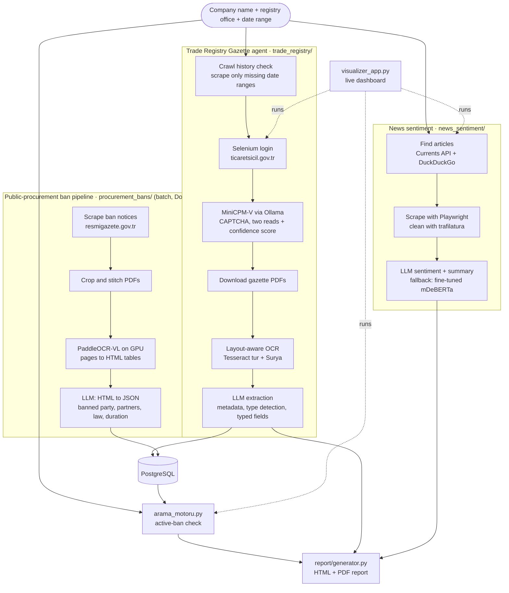

# FinGuard · KKB

**Company risk intelligence from Turkish public records: trade registry gazettes, public-procurement bans and news, in one report.**

[](https://www.python.org/downloads/)
[](https://www.postgresql.org/)
[](https://www.docker.com/)

Give FinGuard a company name, a trade registry office and a date range. It collects what the Turkish state and the press have published about that company, turns scanned PDFs and web pages into structured data with OCR and language models, stores it in PostgreSQL and produces a single risk report.

Built by a five-person team during a hackathon for the KKB challenge. Sample output: [`report/Final_Report.pdf`](report/Final_Report.pdf).

---

## Contents

- [What it does](#what-it-does)
- [Highlights](#highlights)
- [Open-weight models in the pipeline](#open-weight-models-in-the-pipeline)
- [Architecture](#architecture)
- [The pipelines](#the-pipelines)
- [Getting started](#getting-started)
- [Configuration](#configuration)
- [Repository layout](#repository-layout)
- [Known limitations](#known-limitations)
- [Team](#team)

---

## What it does

| Source | What FinGuard extracts | Pipeline |
|---|---|---|
| **Trade Registry Gazette** (Türkiye Ticaret Sicili Gazetesi, `ticaretsicil.gov.tr`) | Mergers, liquidations, capital decreases, address changes, branch openings and 6 more announcement types, each as typed fields | [`trade_registry/`](trade_registry/) |
| **Public-procurement bans** (ban notices in the Official Gazette, `resmigazete.gov.tr`) | Banned company or person, tax / ID number, partners, ministry, legal basis, ban scope and duration | [`procurement_bans/`](procurement_bans/) |
| **News** (Turkish and English) | Relevant articles, sentiment, confidence and a short summary in the article's language | [`news_sentiment/`](news_sentiment/) |

The results meet in PostgreSQL and in an HTML/PDF report ([`report/`](report/)). A small web dashboard ([`visualizer_app.py`](visualizer_app.py)) runs the per-company checks side by side and streams their progress live.

---

## Highlights

- **Open-weight Chinese models do the hard local work.** Baidu's **PaddleOCR-VL** reads scanned ban notices, OpenBMB's **MiniCPM-V** solves the registry portal's CAPTCHA, and Alibaba's **Qwen2.5** ran our first gazette extractor end to end. All three run on our own hardware, so document images never leave the machine. [Details below.](#open-weight-models-in-the-pipeline)
- **An agent that only scrapes what is missing.** The TTSG orchestrator checks the crawl history in PostgreSQL, works out which date ranges are not yet covered and runs scrape → OCR → extract → import only for those gaps.
- **Layout-aware OCR.** Each gazette page is rendered at 400 DPI and classified: standard two-column pages are split and read with Tesseract (Turkish), irregular layouts go to Surya's layout model.
- **Multi-stage LLM extraction with validation.** Metadata extraction → fuzzy company pre-filter (so only relevant sections reach the LLM) → announcement-type detection → type-specific field extraction checked against Pydantic schemas → generic fallback when a schema does not fit.
- **One switch between hosted and local LLMs.** Every LLM call goes through the OpenAI-compatible API, so the same code runs against a hosted `gpt-oss-120b` or a local Qwen2.5 served by Ollama by changing two environment variables.
- **Our own fine-tuned sentiment model.** A multilingual mDeBERTa-v3 fine-tuned on Turkish and English financial news takes over when the hosted LLM is unavailable, so the news pipeline still finishes offline.
- **Built to survive real documents.** GPU out-of-memory pages are retried at 90 %, 80 % and 60 % resolution; CAPTCHA answers are scored from two independent reads before they are submitted; failed LLM calls are retried; failed extractions are logged instead of written as empty rows.

---

## Open-weight models in the pipeline

| Model | Developer | Runs on | Job in FinGuard |
|---|---|---|---|
| **PaddleOCR-VL** (0.9B) | Baidu, PaddlePaddle team | Local NVIDIA GPU, inside the `ihale-app` container | Turns each page of a ban notice into Markdown/HTML with the tables intact, so the LLM can map every column to a field. Layout detection and page-orientation correction are switched on. |
| **MiniCPM-V** | OpenBMB (Tsinghua University and ModelBest) | Local, through Ollama (`minicpm-v`) | Reads the CAPTCHA on the Trade Registry portal. The image is read twice and the answer gets a confidence score from its length, its character set and whether the two reads agree; answers below 0.6 are rejected. Up to 3 attempts per PDF, with manual entry as a fallback (`--no-vlm`). |
| **Qwen2.5-7B** | Alibaba Cloud, Qwen team | Local, through Ollama (`qwen2.5:7b`) | Powered the first version of the gazette extractor ([`prototypes/ticari-sicil/`](prototypes/ticari-sicil/)): type detection, field extraction and the generic fallback, fully offline. The current agent builds on the same schemas and can run on Qwen again (see below). |
| gpt-oss-120b | OpenAI (open-weight) | Hosted, OpenAI-compatible endpoint | High-volume structured extraction (gazettes, ban notices) and news sentiment with summaries. |
| mDeBERTa-v3, fine-tuned by us | Base: Microsoft; NLI checkpoint: `MoritzLaurer/mDeBERTa-v3-base-xnli-multilingual-nli-2mil7` | Local CPU or GPU | Offline sentiment classifier (positive / negative / neutral); takes over any article the hosted LLM fails on. |

**Why these models.** The source documents are Turkish, scanned and table-heavy. PaddleOCR-VL keeps table structure that plain OCR loses, and it is small enough for one consumer GPU. Running OCR and CAPTCHA solving locally means the scanned documents and portal images stay on our machine; only extracted text is sent to the language model.

**Running the gazette agent on local Qwen instead of the hosted model.** Ollama serves an OpenAI-compatible API, so this is configuration only:

```env
OPENAI_API_BASE=http://localhost:11434/v1
OPENAI_API_KEY=ollama        # any non-empty string
OPENAI_MODEL=qwen2.5:7b
```

---

## Architecture



The ban pipeline runs in batch over a date range and fills the `ihale_yasaklilari` table; per-company questions are then answered from the database by `arama_motoru.py`. The gazette agent and the news pipeline run per company.

---

## The pipelines

### 1. Trade Registry Gazette agent (`trade_registry/`)

`app.py` orchestrates the whole run:

1. **Gap detection** (`db/db_utils.py`, `check_crawl_history_str`): compares the requested range with what is already in the database. Fully covered ranges are exported straight from PostgreSQL; only the gaps are scraped.
2. **Scraping** (`ticaret_sicil_scraper.py`): logs in with Selenium, solves the CAPTCHA with MiniCPM-V, searches by office and company title, filters by date and downloads the gazette PDFs.
3. **OCR** (`batch_process_gazettes.py` + `layout_detector.py`): renders pages at 400 DPI; two-column pages are split and read with Tesseract (`tur`), others go through Surya layout detection.
4. **Extraction** (`batch_process_gazettes.py`):
   - gazette metadata (date, issue number, page) by LLM;
   - fuzzy pre-filter with RapidFuzz (threshold 80) so only sections mentioning the company are sent on;
   - announcement-type detection, then type-specific extraction validated with Pydantic, with a generic fallback.
5. **Conversion and import**: `json_to_ilanlar.py` flattens the results (compound announcements become one row per change) and `db/import_to_postgres.py` loads them into the `ilanlar` table and records the crawl.
6. **Report**: `report/generator.py` builds the HTML/PDF report.

Announcement types: `birleşme` (merger), `tasfiye` (liquidation), `sermaye_azaltımı` (capital decrease), `sermaye_taahhüdü` (capital commitment), `mal_varlığı_devri` (asset transfer), `şirket_emtiası_satışı` (company asset sale), `pay_senedi_değişimi` (share certificate exchange), `toplantı_çağrısı` (meeting call), `şube_kuruluşu` (branch opening), `adres_değişikliği` (address change), `bileşik_değişiklik` (compound change), plus `unknown`.

```bash
cd trade_registry
python app.py --office ANKARA --name "TURKCELL" --start-date 2024-01-01 --end-date 2024-12-31
```

Detailed documentation: [`trade_registry/README.md`](trade_registry/README.md) and the presentation diagrams in [`docs/trade_registry_presentation.md`](docs/trade_registry_presentation.md).

### 2. Public-procurement ban pipeline (`procurement_bans/`)

`pipeline.py` runs four stages, each also available on its own with `--mode`:

| Mode | Stage |
|---|---|
| `scrape` | Finds ban notices (yasaklama ilanları) in the Official Gazette archive and downloads the PDFs |
| `stitch` | Crops margins and empty gaps and stitches the content blocks into compact pages for OCR |
| `ocr` | PaddleOCR-VL turns each page into HTML; images are sharpened and contrast-enhanced first, and out-of-memory pages are retried at lower resolution |
| `extract` | The LLM turns each HTML page into JSON (banned party, tax/ID numbers, partners, ministry, contracting authority, legal basis, scope, duration), 5 pages in parallel, and writes it to `ihale_yasaklilari` |
| `all` | All of the above |

It runs in the `ihale-app` container (NVIDIA GPU required for PaddleOCR-VL):

```bash
docker compose up -d --build ihale-app
docker exec -it ihale_container_final bash
python pipeline.py --mode all --start-date 2024-07-22 --end-date 2024-07-20
```

Note: `--start-date` is the **newest** date and `--end-date` the oldest (the scraper walks backwards in time). A ready-made dump with about 7,400 ban records (January 2024 to December 2025) is included as `db/dumps/ihale_yedek.sql`, so the search works without running the scraper. Turkish guide: [`procurement_bans/ReadME.md`](procurement_bans/ReadME.md).

### 3. News sentiment (`news_sentiment/`)

`run_all_parts.py` runs:

1. `url_extractor.py`: Currents API (optional) plus DuckDuckGo, domain blocklist, importance scoring of sources and fuzzy duplicate-title removal.
2. `scraper.py`: parallel headless Playwright browsers.
3. `html_cleaner.py`: article text extraction with trafilatura, on all CPU cores.
4. `fine_tuned_sentimental_classification.py`: the hosted LLM labels each article and writes a 2–3 sentence summary in the article's language (20 parallel requests, retries with backoff). Articles the API fails on are re-scored by the fine-tuned mDeBERTa model. `--uselocalmodel` skips the API entirely.
5. Merge into `merged_results.json`; results under 0.60 confidence are flagged for review.

```bash
cd news_sentiment
python run_all_parts.py --company-name "TURKCELL" --start-date 01.01.2024 --end-date 31.12.2024
```

The model was trained with `fine_tuner.py`. Feature overview (Turkish): [`FEATURES.md`](news_sentiment/FEATURES.md).

### 4. Search, report and dashboard

- **`arama_motoru.py`**: works out each ban's end date from its duration (years, months or days) and returns the bans that were active during the requested dates, matching the name case-insensitively inside the JSONB list of banned parties. Writes `ihale_results.json`.
  ```bash
  python arama_motoru.py -i "TURKCELL" -b 2024.01.01 -s 2024.12.31
  ```
- **`report/generator.py`**: merges ban, gazette and news results into one HTML report, and a PDF if `wkhtmltopdf` is installed.
  ```bash
  cd report
  python generator.py --company-name "TURKCELL" --start-date 01.01.2024 --end-date 31.12.2024
  ```
- **`visualizer_app.py`**: Flask dashboard on <http://localhost:5000>. Enter a company, registry office and dates; it runs the ban search, the gazette scraper and the news pipeline in parallel and streams their output.

---

## Getting started

### Prerequisites

- Python 3.10+ and Docker with Docker Compose
- [Git LFS](https://git-lfs.com/) (for the fine-tuned sentiment model, about 1.1 GB)
- [Ollama](https://ollama.com/) with `minicpm-v` (and `qwen2.5:7b` if you want the local LLM)
- Tesseract OCR with Turkish language data, and Google Chrome (for Selenium)
- An NVIDIA GPU for PaddleOCR-VL (ban pipeline only)
- Optional: `wkhtmltopdf` for PDF reports
- An OpenAI-compatible LLM endpoint and key, or Ollama with Qwen2.5 (see above)

### 1. Clone and configure

```bash
git clone https://github.com/aliemreo/FinGuard-KKB.git
cd FinGuard-KKB
git lfs pull                 # fine-tuned sentiment model
cp .env.example .env         # fill in keys and passwords
```

For the ban pipeline in Docker, also create `procurement_bans/.env` with `API_KEY`, `BASE_URL` and `MODEL` (the container reads that folder).

### 2. Start the database and load data

```bash
docker compose up -d postgres pgadmin

# Trade registry announcements table
docker cp db/ticaret_sicili_db.sql kkb_postgres:/tmp/
docker exec kkb_postgres psql -U kkb_user -d kkb_db -f /tmp/ticaret_sicili_db.sql

# ~7,400 procurement-ban records (replaces the empty table created at startup)
docker exec kkb_postgres psql -U kkb_user -d kkb_db -c "DROP TABLE IF EXISTS ihale_yasaklilari;"
docker cp db/dumps/ihale_yedek.sql kkb_postgres:/tmp/
docker exec kkb_postgres psql -U kkb_user -d kkb_db -f /tmp/ihale_yedek.sql
```

`docker compose up` already creates the `gazettes`, `announcements`, `crawling_history` and `ihale_yasaklilari` tables. Errors saying role `postgres` does not exist while loading the dump are harmless. pgAdmin runs on <http://localhost:5050> (default login `admin@admin.com` / `admin`).

### 3. Local models

```bash
ollama pull minicpm-v        # CAPTCHA solving
ollama pull qwen2.5:7b       # optional: local LLM
```

### 4. Python dependencies

```bash
python -m venv .venv
.venv\Scripts\activate       # Windows; on Linux/macOS: source .venv/bin/activate
pip install -r requirements.txt surya-ocr flask
pip install -r news_sentiment/requirements.txt
playwright install chromium
```

### 5. Run

```bash
python visualizer_app.py     # dashboard on http://localhost:5000
```

or run any pipeline on its own as shown in [The pipelines](#the-pipelines).

---

## Configuration

All settings live in `.env` (template: [`.env.example`](.env.example)). The components were written by different team members, so the same database and LLM appear under two naming schemes; set both.

| Variable | Used by |
|---|---|
| `OPENAI_API_KEY`, `OPENAI_API_BASE`, `OPENAI_MODEL` | Gazette agent, news sentiment |
| `API_KEY`, `BASE_URL`, `MODEL` | Ban pipeline (`procurement_bans/`) |
| `POSTGRES_USER`, `POSTGRES_PASSWORD`, `POSTGRES_DB`, `POSTGRES_PORT` | docker-compose, `db/` scripts, gazette agent |
| `DB_HOST`, `DB_PORT`, `DB_NAME`, `DB_USER`, `DB_PASSWORD` | Ban pipeline, `arama_motoru.py` |
| `EMAIL`, `PASSWORD` | Trade Registry portal login |
| `CURRENTS_API_KEY` | News search (optional; DuckDuckGo only without it) |
| `OLLAMA_HOST` | Ollama server address, if not `127.0.0.1:11434` |
| `GAZETTE_DIR`, `OUTPUT_DIR` | Where the gazette agent keeps PDFs and OCR output |

The default LLM endpoint is `...` with `gpt-oss-120b`. Any OpenAI-compatible provider works.

---

## Repository layout

```
FinGuard-KKB/
├── trade_registry/             1 · Trade Registry Gazette agent (TTSG)
│   ├── app.py                  orchestrator: gap detection → scrape → OCR → extract → import → report
│   ├── ticaret_sicil_scraper.py  Selenium scraper + MiniCPM-V CAPTCHA solver
│   ├── batch_process_gazettes.py OCR + multi-stage LLM extraction
│   ├── layout_detector.py      page layout classification, Surya OCR
│   └── json_to_ilanlar.py      flattens extractions for the database
├── procurement_bans/           2 · public-procurement ban pipeline
│   ├── pipeline.py             scrape → stitch → PaddleOCR-VL → LLM → DB
│   ├── init.sql                `ihale_yasaklilari` table
│   └── Dockerfile, docker-compose.yaml (standalone)
├── news_sentiment/             3 · news sentiment pipeline
│   ├── run_all_parts.py        entry point
│   ├── url_extractor.py, scraper.py, html_cleaner.py
│   ├── fine_tuned_sentimental_classification.py   LLM + fine-tuned mDeBERTa fallback
│   ├── fine_tuner.py           training script
│   └── finetuned_sentiment_model/ (Git LFS)
├── report/                     report generator, sample inputs and sample report
├── arama_motoru.py             active-ban search
├── visualizer_app.py           Flask dashboard
├── db/
│   ├── database_schema.sql     gazettes, announcements, crawl history
│   ├── ticaret_sicili_db.sql   `ilanlar` table
│   ├── dumps/                  ~7,400 ban records (ihale_yedek.sql) and an earlier 2023–25 dump
│   └── db_utils.py, import_*.py  connection pool, crawl history, importers
├── prototypes/ticari-sicil/    first version: local Qwen2.5-7B extractor, parallel batch runner, sample gazettes
├── docs/                       Docker notes, layout-analysis design (TR), TTSG presentation, announcement types (TR)
├── archive/                    backup copies and superseded standalone scripts (see archive/README.md)
├── docker-compose.yml          PostgreSQL, pgAdmin, ban pipeline container
└── .env.example                configuration template
```

---

## Known limitations

- The gazette agent and the dashboard were developed on Windows; the ban pipeline runs in a Linux container.
- The ban pipeline image builds on a prebuilt PaddleOCR base image (`ozcanal22/my-paddleocr-normal:v1`) and needs an NVIDIA GPU.
- The `news-scanner` service in `docker-compose.yml` has no Dockerfile yet; run the news pipeline locally as shown above.
- The scrapers depend on the current layout of `ticaretsicil.gov.tr` and `resmigazete.gov.tr`. Use them with your own account and within those sites' terms of use.

---

## Team

| | Main areas |
|---|---|
| Ali Emre Özcan | Trade Registry scraper and VLM CAPTCHA solving, gazette OCR and LLM extraction, Qwen prototype |
| Fuat Karakaya | TTSG orchestrator, database layer, layout analysis |
| Ömer Faruk Ekmekçi | News sentiment pipeline and fine-tuned model, report generator, dashboard |
| Zahid Enes Navruz | Public-procurement ban pipeline with PaddleOCR-VL |
| Furkan Kalay | Ban pipeline and integration |

---

## License

All rights reserved. The code is provided to the hackathon organizer for evaluation only; any other use needs written permission from the authors. See [LICENSE](LICENSE).
