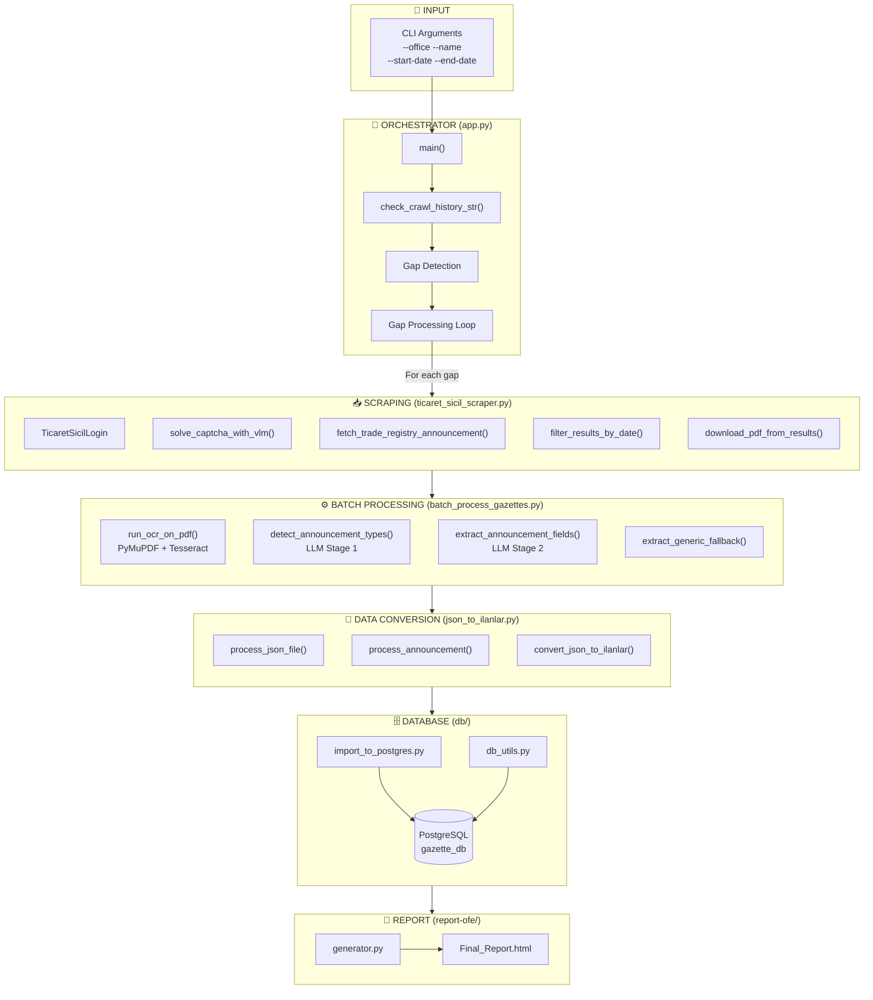
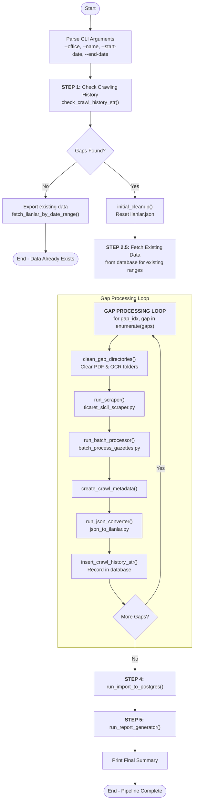
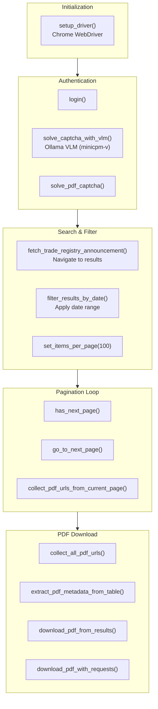
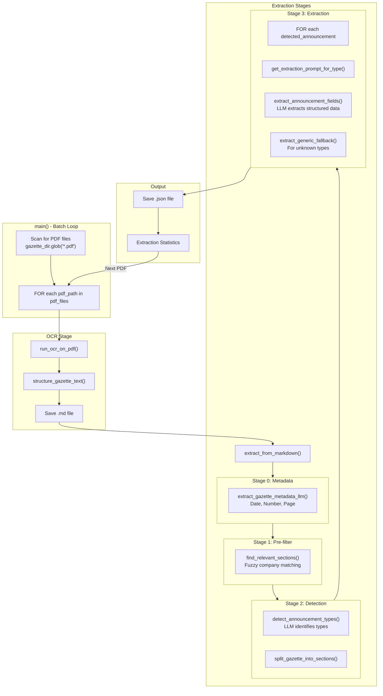
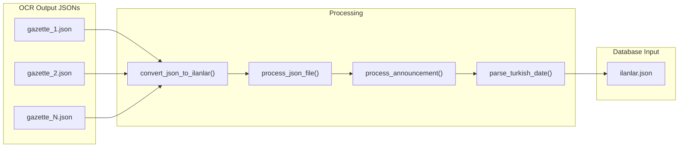
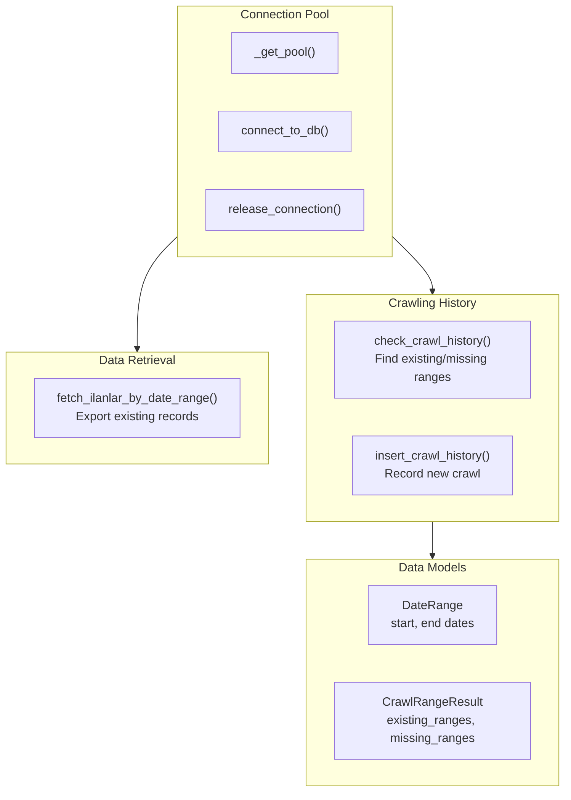
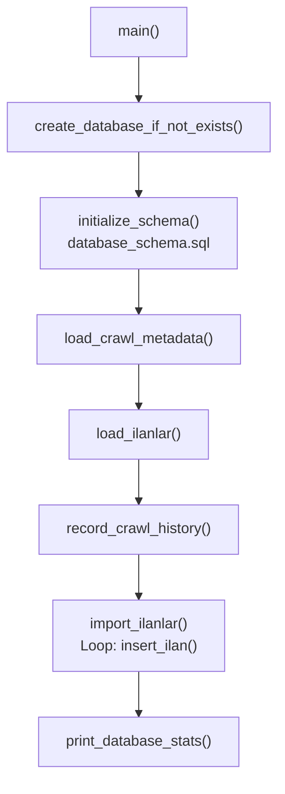

# TTSG_Agent Pipeline Documentation

Automated pipeline for scraping, OCR processing, and extracting structured data from Turkish Trade Registry Gazettes (TTSG).

---

## 📊 Pipeline Architecture Overview



---

## 🔄 Main Orchestrator Flow (`app.py`)

### Entry Point: `main()`



### Key Functions in `app.py`

| Function | Purpose | Called By |
|----------|---------|-----------|
| `main()` | Main orchestrator entry point | CLI |
| `initial_cleanup()` | Reset `ilanlar.json` to empty array | `main()` |
| `clean_gap_directories()` | Clear PDF and OCR output folders | Gap loop |
| `create_crawl_metadata()` | Create `crawl_metadata.json` | Gap loop |
| `run_scraper()` | Execute web scraper subprocess | Gap loop |
| `run_batch_processor()` | Execute OCR + extraction subprocess | Gap loop |
| `run_json_converter()` | Execute JSON format converter | Gap loop |
| `run_import_to_postgres()` | Import data to PostgreSQL | `main()` |
| `run_report_generator()` | Generate HTML report | `main()` |

---

## 📥 Web Scraping Module (`ticaret_sicil_scraper.py`)

### Class: `TicaretSicilLogin`



### Key Methods

| Method | Lines | Purpose |
|--------|-------|---------|
| `__init__()` | 34-41 | Initialize driver, credentials |
| `setup_driver()` | 43-79 | Configure Chrome WebDriver |
| `solve_captcha_with_vlm()` | 235-478 | VLM-based CAPTCHA solving |
| `login()` | 555-729 | Website authentication |
| `fetch_trade_registry_announcement()` | 751-972 | Search for announcements |
| `filter_results_by_date()` | 974-1218 | Apply date filtering |
| `extract_pdf_metadata_from_table()` | 1275-1351 | Get PDF metadata |
| `download_pdf_from_results()` | 1599-1812 | Download all PDFs |

---

## ⚙️ Batch Processing Module (`batch_process_gazettes.py`)

### Processing Pipeline



### Data Models (Pydantic)

| Model | Purpose |
|-------|---------|
| `UniversalMetadata` | Registry office, MERSİS no, company name |
| `AnnouncementType` | Enum of 11 announcement types |
| `GazetteAnnouncement` | Complete announcement with metadata + content |
| `DetectedAnnouncement` | LLM detection result |
| `MergerAnnouncement` | Merger-specific fields |
| `BranchEstablishmentAnnouncement` | Branch setup fields |
| `AddressChangeAnnouncement` | Address change fields |
| `CompoundAnnouncement` | Mixed/complex announcements |
| `UnknownAnnouncement` | Fallback for unknown types |

### Announcement Types (`AnnouncementType` Enum)

```python
COMMODITY_SALE      = "şirket_emtiası_satışı"   # 1
CAPITAL_DECREASE    = "sermaye_azaltımı"        # 2
ASSET_TRANSFER      = "mal_varlığı_devri"       # 3
LIQUIDATION         = "tasfiye"                  # 4
SHARE_EXCHANGE      = "pay_senedi_değişimi"     # 5
MEETING_CALL        = "toplantı_çağrısı"        # 6
CAPITAL_COMMITMENT  = "sermaye_taahhüdü"        # 7
MERGER              = "birleşme"                 # 8
BRANCH_ESTABLISHMENT= "şube_kuruluşu"           # 9
ADDRESS_CHANGE      = "adres_değişikliği"       # 10
COMPOUND            = "bileşik_değişiklik"      # 11
UNKNOWN             = "unknown"
```

---

## 🔄 Data Conversion Module (`json_to_ilanlar.py`)

### Conversion Flow



### Key Transformations

| Source Field | Target Field | Transformation |
|--------------|--------------|----------------|
| `announcement_type` | `ilan_turu` | String → Integer mapping |
| `gazette_metadata.date` | `ilan_tarihi` | Turkish → ISO date |
| `filter_settings.city_filter` | `il` | City name → Plaka code |
| `metadata.announcement_number` | `ilan_no` | Direct mapping |
| `metadata.company_name` | `unvan` | Direct mapping |
| `raw_text` | `metin` | Full announcement text |

---

## 🗄️ Database Module (`db/`)

### `db_utils.py` - Core Utilities



### `import_to_postgres.py` - Data Import



---

## 📁 Directory Structure

```
TTSG_Agent/
├── app.py                      # 🔄 Main orchestrator
├── ticaret_sicil_scraper.py    # 📥 Web scraper (2050 lines)
├── batch_process_gazettes.py   # ⚙️ OCR + extraction (1536 lines)
├── json_to_ilanlar.py          # 🔄 Data converter (375 lines)
├── layout_detector.py          # 📐 Layout detection
├── scrapped_pdf_files/         # 📄 Downloaded PDFs
└── OCR_outputs/
    ├── markdown/               # 📝 OCR text output
    └── json/                   # 📊 Structured data

db/
├── db_utils.py                 # 🔧 Database utilities
├── import_to_postgres.py       # 📥 Data importer
├── database_schema.sql         # 🗄️ Schema definition
└── db_Input/
    ├── crawl_metadata.json     # 📋 Crawl session info
    └── ilanlar.json            # 📊 Announcements data

report-ofe/
└── generator.py                # 📄 Report generator
```

---

## 🚀 Quick Start

```bash
# Full pipeline execution
python app.py --office ANKARA --name TURKCELL --start-date 2024-01-01 --end-date 2024-12-31

# Only batch processing (PDFs already downloaded)
python batch_process_gazettes.py --name "MICROSOFT"

# Only JSON conversion
python json_to_ilanlar.py

# Only database import
python ../db/import_to_postgres.py
```

---

## ⚙️ Configuration (`.env`)

```env
# Scraper credentials
EMAIL=your_email@example.com
PASSWORD=your_password

# Directories
GAZETTE_DIR=scrapped_pdf_files
OUTPUT_DIR=OCR_outputs

# LLM API
OPENAI_API_KEY=sk-XXXX
OPENAI_API_BASE=https://mia.csp.kloudeks.com/v1
OPENAI_MODEL=gpt-oss-120b

# Database
POSTGRES_DB=gazette_db
POSTGRES_USER=postgres
POSTGRES_PASSWORD=1234
DB_HOST=localhost
POSTGRES_PORT=5432
```

---

## 📊 Data Flow Summary

```
┌─────────────────┐     ┌─────────────────┐     ┌─────────────────┐
│   Web Portal    │────▶│   PDF Files     │────▶│   Markdown      │
│  ticaretsicil   │     │  (.pdf)         │     │  (.md)          │
│   .gov.tr       │     │                 │     │                 │
└─────────────────┘     └─────────────────┘     └─────────────────┘
        │                       │                       │
        │                       │                       │
        ▼                       ▼                       ▼
   CAPTCHA SOLVE           OCR (PyMuPDF            LLM EXTRACTION
   + DOWNLOAD              + Tesseract)            (OpenAI API)
                                                        │
                                                        ▼
┌─────────────────┐     ┌─────────────────┐     ┌─────────────────┐
│   PostgreSQL    │◀────│  ilanlar.json   │◀────│   JSON Files    │
│   gazette_db    │     │  (converted)    │     │  (structured)   │
│                 │     │                 │     │                 │
└─────────────────┘     └─────────────────┘     └─────────────────┘
        │
        ▼
┌─────────────────┐
│  HTML Report    │
│  Final_Report   │
└─────────────────┘
```

---

## 🔑 Key Processing Loops

### 1. Gap Processing Loop (`app.py:403-434`)
```
FOR each gap in gaps:
    1. clean_gap_directories()
    2. run_scraper(office, name, gap_start, gap_end)
    3. run_batch_processor(name)
    4. create_crawl_metadata(...)
    5. run_json_converter()
    6. insert_crawl_history_str(...)
```

### 2. PDF Processing Loop (`batch_process_gazettes.py:1428-1486`)
```
FOR each pdf_path in pdf_files:
    1. run_ocr_on_pdf(pdf_path, md_path)
    2. extract_from_markdown(md_path, json_path, company_filter)
```

### 3. Announcement Extraction Loop (`batch_process_gazettes.py:1116-1222`)
```
FOR each detected in detected_announcements:
    1. normalize_announcement_type()
    2. Find relevant_section
    3. extract_announcement_fields()
    4. IF validation fails → extract_generic_fallback()
    5. Append to final_announcements
```

### 4. Pagination Loop (`ticaret_sicil_scraper.py:1447-1481`)
```
WHILE has_next_page():
    1. collect_pdf_urls_from_current_page()
    2. go_to_next_page()
```

---

## 📝 Notes

- **CAPTCHA**: Requires manual solving or VLM (Ollama minicpm-v model)
- **OCR**: Uses PyMuPDF for rendering + Tesseract for text extraction
- **LLM**: OpenAI-compatible API for announcement detection and field extraction
- **Database**: PostgreSQL with connection pooling via psycopg2
