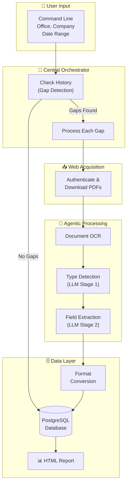
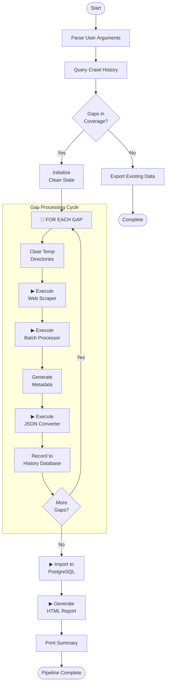
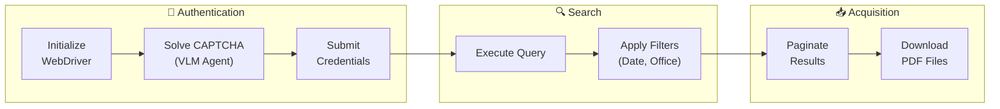
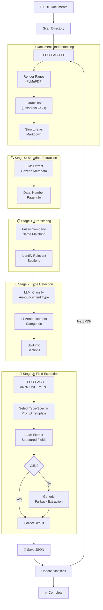

# TTSG Pipeline — Presentation Overview

> Agentic pipeline for automated extraction and structuring of Turkish Trade Registry Gazettes.

---

## 🌐 Schema 1: General Pipeline Overview

This schema shows the high-level flow from user input to final database storage and reporting.



### 📦 Used Modules

| Layer | Module |
|-------|--------|
| Orchestrator | `app.py` |
| Web Acquisition | `ticaret_sicil_scraper.py` |
| Agentic Processing | `batch_process_gazettes.py` |
| Format Conversion | `json_to_ilanlar.py` |
| Database | `db/db_utils.py`, `db/import_to_postgres.py` |
| Reporting | `report-ofe/generator.py` |

---

## 🧠 Schema 2: Orchestrator Agent (`app.py`)

This schema illustrates the intelligent orchestration logic that coordinates the entire pipeline.



### 📦 Used Modules

| Stage | Module |
|-------|--------|
| Orchestrator Core | `app.py` |
| History Management | `db/db_utils.py` |
| Subprocess Runners | Internal subprocess calls to other modules |

---

## 🌐 Schema 3: Web Acquisition (Minimal)

A simplified view of the web scraping authentication and download process.



### 📦 Used Modules

| Stage | Module |
|-------|--------|
| Web Automation | `ticaret_sicil_scraper.py` |
| CAPTCHA Solving | Ollama VLM (minicpm-v) |
| Browser Driver | Selenium WebDriver |

---

## 🤖 Schema 4: Agentic Batch Processor (`batch_process_gazettes.py`)

This is the **core intelligence layer** — a multi-stage LLM-powered extraction pipeline.



### 🏷️ Announcement Type Categories

| # | Type | Description |
|---|------|-------------|
| 1 | Commodity Sale | Sale of company goods |
| 2 | Capital Decrease | Reduction in capital |
| 3 | Asset Transfer | Transfer of assets |
| 4 | Liquidation | Company dissolution |
| 5 | Share Exchange | Stock exchange |
| 6 | Meeting Call | Shareholder meeting |
| 7 | Capital Commitment | Capital pledges |
| 8 | Merger | Company merger |
| 9 | Branch Establishment | New branch |
| 10 | Address Change | Location update |
| 11 | Compound | Multiple changes |

### 📦 Used Modules

| Stage | Module / Technology |
|-------|---------------------|
| Batch Processor Core | `batch_process_gazettes.py` |
| PDF Rendering | PyMuPDF |
| Text Extraction | Tesseract OCR |
| LLM Intelligence | OpenAI-compatible API |
| Data Validation | Pydantic Models |

---

## 📊 Data Flow At-a-Glance

```
┌────────────┐     ┌────────────┐     ┌────────────┐     ┌────────────┐
│  Gov Site  │────▶│    PDFs    │────▶│  Markdown  │────▶│   LLM      │
│ (CAPTCHA)  │     │            │     │   (OCR)    │     │ Extraction │
└────────────┘     └────────────┘     └────────────┘     └────────────┘
                                                               │
      ┌────────────────────────────────────────────────────────┘
      ▼
┌────────────┐     ┌────────────┐     ┌────────────┐
│ Structured │────▶│ PostgreSQL │────▶│    HTML    │
│   JSON     │     │  Database  │     │   Report   │
└────────────┘     └────────────┘     └────────────┘
```

---

## 🔗 Complete Module Reference

| Module | Purpose | Key Technologies |
|--------|---------|------------------|
| `app.py` | Central orchestrator, gap detection, subprocess coordination | Python subprocess, argparse |
| `ticaret_sicil_scraper.py` | Web authentication, CAPTCHA solving, PDF download | Selenium, Ollama VLM |
| `batch_process_gazettes.py` | OCR, LLM-based extraction, type detection | PyMuPDF, Tesseract, OpenAI API, Pydantic |
| `json_to_ilanlar.py` | Format conversion for database import | JSON processing |
| `db/db_utils.py` | Database utilities, history management | psycopg2, connection pooling |
| `db/import_to_postgres.py` | Data import to PostgreSQL | psycopg2 |
| `report-ofe/generator.py` | HTML/PDF report generation | HTML templating |
