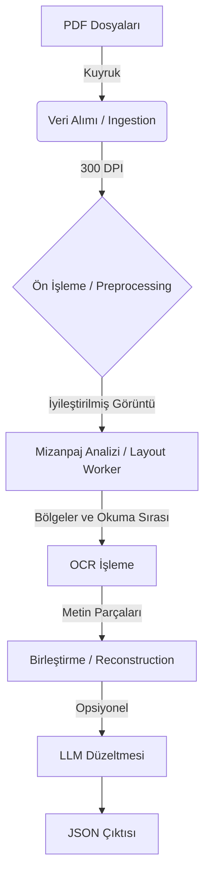

# 📄 PDF Veri Akış ve OCR Hattı (Pipeline)

Bu proje, PDF belgelerini işleyerek anlamlı ve yapılandırılmış metin verisine (JSON) dönüştüren kapsamla bir **OCR ve mizanpaj analiz sistemidir**.  
Sistem; yüksek çözünürlüklü görüntüleme, gelişmiş mizanpaj analizi, OCR ve LLM tabanlı hata düzeltme adımlarını içerir.

---

## 🔄 Veri Akış Diyagramı

---

## 🧬 Süreç Adımları ve Teknik Detaylar

### 1. 📥 Veri Alımı (Ingestion)
- Sisteme yüklenen PDF dosyaları işleme kuyruğuna (**Queue**) alınır.  
- **Dönüştürme:** PDF sayfaları, Türkçe karakterlerdeki (noktalar, aksanlar) veri kaybını önlemek amacıyla **300 DPI çözünürlükte görüntüye dönüştürülür.**  
- **Kütüphaneler:** `pdf2image`, `PyMuPDF`.

---

### 2. 🧪 Ön İşleme (Preprocessing Worker)
OCR başarısını artırmak için görüntü üzerinde iyileştirmeler yapılır. Bu adımlar model gereksinimlerine göre konfigüre edilebilir:

- **Gri Tonlama (Grayscale):** OpenCV kullanılarak renk kanalları tek kanala indirgenir.  
- **Eğrilik Düzeltme (Deskewing):** Hough Transform algoritması ile tarama kaynaklı eğrilikler giderilir.  
- **Binarizasyon:** Gerekli durumlarda **Sauvola yöntemi** ile görüntü siyah-beyaz (binary) hale getirilir.

---

### 3. 🧮 Mizanpaj Analizi (Layout Worker - GPU)
Temizlenmiş görüntü, belge yapısını anlamlandırmak için derin öğrenme modellerine beslenir.

- **Modeller:** `Surya`, `LayoutParser`  
- **Tespit:** Sayfa üzerindeki bölgeler `"Text"`, `"Table"`, `"Title"` olarak sınıflandırılır.  
- **Kritik İşlev:** Surya modeli, bölgelerin insan gözünü uygun **okuma sırasını (Reading Order)** belirler ve sıralı bir JSON çıktısı üretir.

---

### 4. ⚙️ İşleme (Processing)
Mizanpaj analizinde `"Text"` olarak etiketlenen alanlar OCR işlemine alınır.

- **Kırpma (Cropping):** Tespit edilen metin blokları ana görüntüdan kesilir.  
- **OCR:** Her bir parça **PaddleOCR** motoruna gönderilir ve metin içeriği + karakter koordinatları elde edilir.

---

### 5. 🔧 Birleştirme ve Son İşleme (Reconstruction & Post-Processing)
Parçalı OCR çıktıları, mizanpaj analizinden gelen sayfa koordinatlarına sadık kalınarak yeniden birleştirilir.

---

### 6. 🤖 LLM Düzeltmesi (Opsiyonel / Önerilen)
OCR hatalarını minimize etmek için kritik veri alanları (örneğin **Şirket Unvanı**) küçük ölçekli bir Dil Modeli (LLM) ile kontrol edilir.

- **Model:** `Llama-3-8B-Turkish` (veya benzeri)  
- **İşlev:** OCR kaynaklı yazım hatalarını bağlamsal olarak düzeltir.  
  - Örnek: `"S1RKET"` → `"ŞİRKET"`

---

### 7. 📤 Çıktı
İşlenen veriler, arama motorları ve veritabanı indekslemesi için optimize edilmiş **JSON formatında** dışa aktarılır.